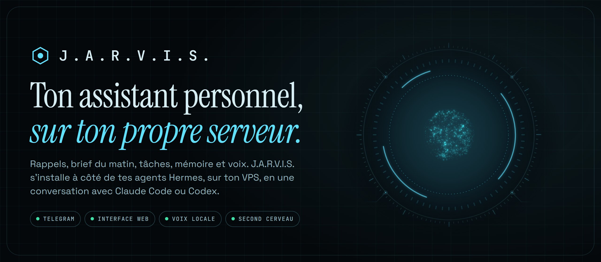
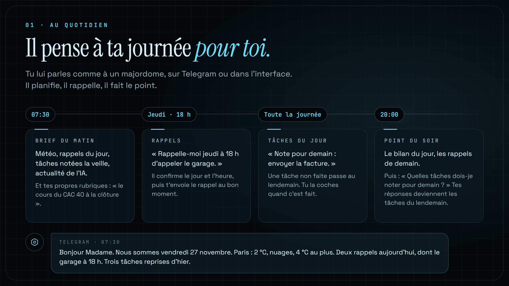
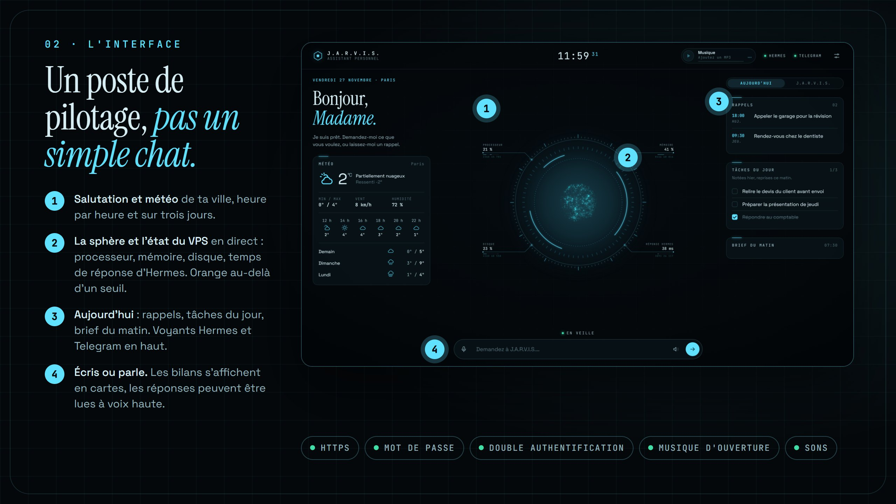
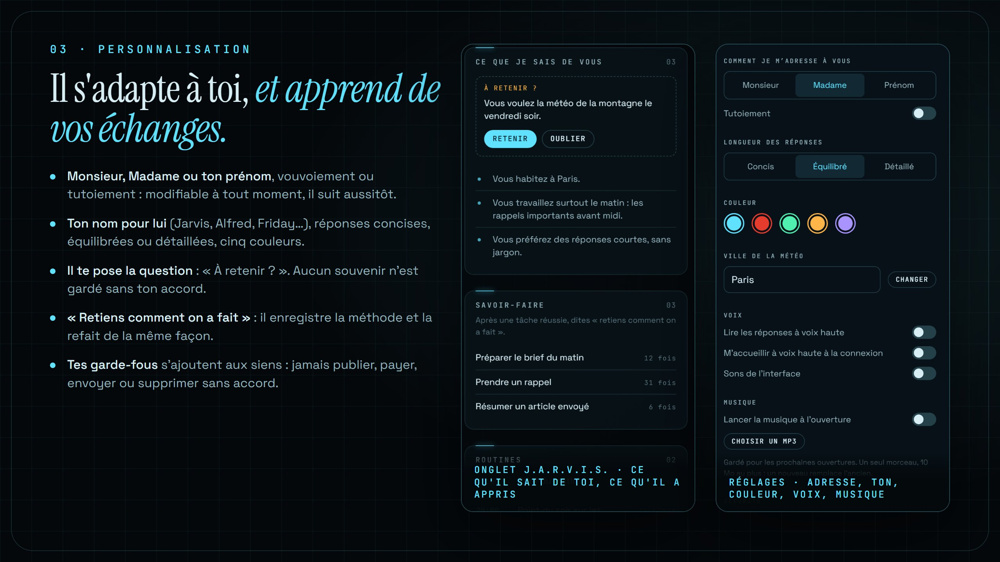
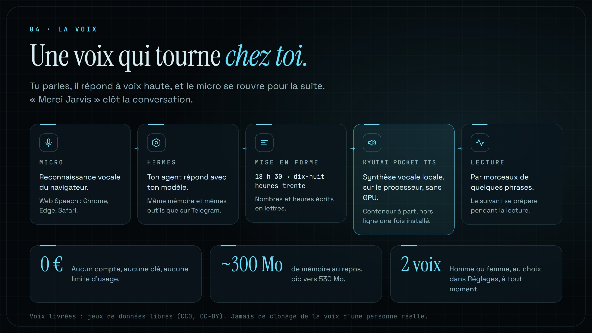

<p align="center">
  
</p>

<h1 align="center">ottho-jarvis</h1>

<p align="center">
  <strong>Un assistant personnel façon Jarvis, installé sur ton VPS à côté de tes agents Hermes.</strong><br>
  Plugin Ottho Academy pour Claude Code et Codex : tu réponds à quelques questions, il fait le reste.
</p>

<p align="center">
  
  
  
  
  
  
</p>

<p align="center">
  <a href="#au-quotidien">Au quotidien</a> ·
  <a href="#linterface">L'interface</a> ·
  <a href="#personnalisation-et-apprentissage">Personnalisation</a> ·
  <a href="#la-voix">La voix</a> ·
  <a href="#à-côté-de-tes-autres-agents">Architecture</a> ·
  <a href="#installation">Installation</a> ·
  <a href="#sécurité-et-confidentialité">Sécurité</a>
</p>

---

Jarvis n'est pas un chatbot de plus. C'est **ton** assistant : il connaît ton nom, ta ville, tes habitudes, ce que tu lui as confié. Il t'envoie ton brief chaque matin, il te rappelle ce qu'il faut au bon moment, il note tes tâches. Et tout tourne **sur ton propre serveur**, comme un profil de plus dans ton Hermes.

- **Sur Telegram** : un bot à lui, qui ne répond qu'à toi (et aux personnes que tu autorises).
- **Dans le navigateur**, en option : une interface animée avec sa sphère de particules, ta journée, l'état de ton VPS et la discussion, au clavier ou à la voix.
- **Avec ta voix et la sienne** : il t'écoute, il te répond à voix haute, avec une synthèse vocale qui tourne sur ton VPS.

## Au quotidien

<p align="center"></p>

Tu lui parles normalement, sur Telegram ou dans l'interface.

| Tu dis | Jarvis fait |
|---|---|
| « Rappelle-moi jeudi à 18 h d'appeler le garage. » | Il crée un rappel unique, confirme le jour et l'heure exacts, puis t'écrit au bon moment. Sans heure précise, il propose 9 h et le dit. |
| « Note pour demain : envoyer la facture. » | La tâche entre dans la liste de demain. Une tâche non faite passe au jour suivant. |
| « Qu'est-ce que dit mon cerveau sur… ? » | Avec le second cerveau branché, il cherche d'abord dans tes notes, répond en s'appuyant dessus et cite la page. |
| « Quoi de neuf sur … ? » | Il cherche sur le web et cite la source et la date. |
| « Fais-moi le point. » | Dans l'interface, il répond par une carte : tâches faites, restantes, prochain rappel. |

**Le brief du matin** arrive à l'heure que tu choisis (7 h 30 par défaut) : météo de ta ville, rappels du jour, tâches notées la veille, actualité de l'IA. Tu retires les rubriques qui ne te servent pas et tu ajoutes les tiennes, en disant simplement quoi chercher (« le cours du CAC 40 à la clôture »). Dix lignes au plus, rien d'inventé : une rubrique sans nouvelle dit « rien de notable ».

**Le point du soir** (20 h par défaut, en option) fait le bilan de la journée, annonce les rappels de demain, puis te demande quelles tâches noter pour le lendemain. Tes réponses deviennent les tâches du jour suivant.

**Le second cerveau** (en option) branche un dossier de notes de ton VPS, en lecture seule : tes méthodes, la documentation d'un projet, un coffre Obsidian. Jarvis n'a accès à rien d'autre que ce dossier.

## L'interface

<p align="center"></p>

Une page web à ton adresse (par exemple `jarvis.ton-domaine.fr`), pensée comme un poste de pilotage.

- **La sphère** : un nuage de particules animé au centre, dans un cercle gradué façon HUD. Elle change d'état quand Jarvis écoute, réfléchit ou parle.
- **L'état du VPS en direct**, autour de la sphère et mis à jour toutes les 10 secondes : processeur, mémoire, disque et temps de réponse d'Hermes. Un indicateur passe en orange avec un triangle d'alerte au-delà d'un seuil : processeur ou mémoire à 90 %, disque à 85 %, Hermes au-delà de 1,5 s.
- **La météo** de ta ville, heure par heure et sur trois jours (Open-Meteo, sans clé).
- **L'onglet « Aujourd'hui »** : tes rappels, tes tâches du jour à cocher et le brief du matin, rubrique par rubrique.
- **L'onglet « J.A.R.V.I.S. »** : ce qu'il sait de toi, ses savoir-faire appris et ses routines (voir plus bas).
- **Les voyants Hermes et Telegram** en haut de l'écran : tu vois tout de suite si quelque chose ne répond plus.
- **La discussion**, au clavier ou au micro. Les bilans et comparaisons s'affichent en cartes lisibles.
- **Une musique d'ouverture**, si tu veux : ton propre MP3, joué au lancement puis atténué sous la voix. Aucune musique n'est livrée avec le plugin, pour une question de droits d'auteur.
- **Des sons d'interface** discrets (allumage de la sphère, apparition des panneaux, chargement), synthétisés pour le plugin. Tu peux remplacer chacun par ton propre son.

L'interface est servie en **HTTPS** (certificat Let's Encrypt gratuit via Traefik), protégée par un **mot de passe** et une **double authentification** (code à 6 chiffres d'une application comme Google Authenticator, 2FAS, Aegis ou 1Password, plus 10 codes de secours).

## Personnalisation et apprentissage

<p align="center"></p>

### À l'installation

Un questionnaire, une question à la fois, toujours avec une valeur proposée par défaut :

- le **nom de ton assistant** (Jarvis, Alfred, Friday…) ;
- **comment il s'adresse à toi** : Monsieur, Madame ou ton prénom, en **vouvoyant** ou en **tutoyant** ;
- la **longueur de ses réponses** : concises, équilibrées ou détaillées ;
- ta **ville** pour la météo et le fuseau horaire ;
- l'heure et les rubriques du **brief**, le **point du soir** ;
- le **second cerveau** à brancher, ou pas ;
- tes **règles en plus**, qui s'ajoutent aux siennes ;
- pour l'interface : la **couleur** (cyan, rouge, vert, ambre, violet), la **voix** (homme ou femme), la **musique** d'ouverture et la **double authentification**.

Avant d'installer quoi que ce soit, tu vois un récapitulatif et un aperçu de sa personnalité, et tu valides.

### À tout moment, dans Réglages

L'adresse (Monsieur, Madame, prénom), le **tutoiement**, la longueur des réponses, la couleur, la ville, la voix, la lecture à voix haute, l'accueil parlé, les sons, la musique et la sécurité se changent depuis l'interface, sans rien réinstaller.

**Tu ou vous ?** Le changement vaut aussitôt dans l'interface : chaque demande rappelle à Jarvis le réglage du moment, y compris pour ses formules de politesse. Dis « merci Jarvis » : il répondra « Je vous en prie, Madame. » ou « Je t'en prie, Claire. », sans jamais servir deux fois de suite la même formule. Sur Telegram, il garde le choix fait à l'installation ; le skill `personnaliser` le change aussi là-bas.

### Il apprend de vos échanges

- **Il te pose la question.** Quand il apprend quelque chose d'utile sur toi (une préférence, une habitude, un contexte durable), il propose de le retenir. La proposition apparaît dans l'onglet J.A.R.V.I.S., marquée **« À retenir ? »**. **Rien n'est gardé sans ton accord.** Hermes valide les souvenirs par une commande de messagerie : l'interface te donne la commande à envoyer sur Telegram (`/memory approve`). Il ne retient jamais de mot de passe, de code, de numéro de carte ni de donnée de santé.
- **Sa façon de répondre évolue.** Ce qu'il sait de toi guide ses réponses : si tu lui as dit préférer des réponses courtes et sans jargon, il s'y tient. Quand il te connaît assez, il se permet parfois une pointe d'humour tirée de tes habitudes.
- **Il apprend des savoir-faire.** Après une tâche réussie, dis « retiens comment on a fait » : il enregistre la méthode (un nom court, les étapes, les pièges à éviter), tu valides, et la prochaine fois il refait pareil. Ses savoir-faire s'affichent dans l'onglet J.A.R.V.I.S., avec le nombre d'utilisations.
- **Même mémoire partout.** Telegram et l'interface parlent au même agent, avec la même mémoire durable et les mêmes outils. Seul le fil de conversation est propre à chaque canal.

### Ses garde-fous

Il ne publie rien, ne paie rien, n'envoie aucun message et ne supprime rien sans ton accord. Tes propres règles s'ajoutent à celles-là, jamais à la place. Il n'a ni terminal, ni accès aux fichiers du serveur, ni navigateur : il agit seulement par ses outils (mémoire, savoir-faire, tâches planifiées, web, tâches du jour, second cerveau en lecture seule).

## La voix

<p align="center"></p>

### Il te parle : Kyutai Pocket TTS, sur ton VPS

La synthèse vocale est **[Pocket TTS](https://github.com/kyutai-labs/pocket-tts)**, de Kyutai, un modèle léger qui tourne sur le processeur, sans carte graphique.

- **Locale et gratuite** : aucun compte, aucune clé d'API, aucune limite d'usage. Le texte lu ne quitte pas ton serveur.
- **Son propre conteneur** (`<profil>-voix`), sur le réseau interne seulement. Le binaire officiel (v4.0.1) est vérifié par empreinte SHA-256 à la construction de l'image ; le modèle français est téléchargé une seule fois, puis le conteneur tourne hors ligne.
- **Deux voix, au choix dans Réglages** : une voix d'homme (« Peter Yearsley », licence CC0) et une voix française de femme (jeu de données CML-TTS, licence CC-BY 4.0). La nouvelle voix se présente dès que tu la choisis.
- **Mémoire** : environ 300 Mo au repos, pic vers 530 Mo. Un modèle plus riche (`french_24l`) existe, deux fois plus lent et plus gourmand (pic vers 1,1 Go) ; l'installation ne le propose que si ton VPS a la place.
- **Bien prononcé** : avant la synthèse, les nombres et les heures sont écrits en lettres (« 18 h 30 » devient « dix-huit heures trente »).
- **Sans attente** : les réponses longues sont lues par morceaux de quelques phrases ; le suivant se prépare pendant la lecture.
- **Accueil parlé** à la connexion, si tu le veux : l'heure, la météo et le nombre de tâches du jour.

Si le conteneur ne répond pas, l'interface passe sur la voix du navigateur, moins naturelle.

### Tu lui parles : mode conversation

Un clic sur le micro ouvre une conversation : tu parles, il répond à voix haute, puis le micro se rouvre tout seul pour la suite. La conversation se ferme sur « merci Jarvis », après 8 secondes de silence ou sur un nouveau clic. La musique s'efface pendant l'écoute.

La reconnaissance vocale est celle du navigateur (Web Speech) : elle marche dans Chrome, Edge et Safari, pas dans Firefox. Dans Chrome, ce que tu dis est transcrit par les serveurs de Google. Il n'y a pas de mot d'éveil (« Hey Jarvis ») : il faudrait un micro ouvert en permanence.

Les voix livrées viennent de jeux de données libres. Le plugin ne clone jamais la voix d'une personne réelle.

## À côté de tes autres agents

Jarvis s'ajoute à ton installation Hermes **sans rien casser** : c'est un profil de plus, à côté de tes autres agents.

```
Ton ordinateur                          Ton VPS
──────────────                          ───────────────────────────────────────────────
Claude Code ou Codex                    Conteneur Hermes existant (détecté)
  skills ottho-jarvis      SSH        ├─ tes agents habituels (intacts)
  .ottho-jarvis/          ───────►    └─ profil jarvis : personnalité, mémoire,
    jarvis    (lanceur)                       routines, bot Telegram, API à sa clé
    <profil>.config.json
                                        <profil>-services   tâches du jour, second cerveau (lecture seule)
                                        <profil>-web        interface, derrière Traefik (HTTPS)
                                        <profil>-voix       Kyutai Pocket TTS (réseau interne)
                                        /opt/ottho-jarvis   le kit, les instances, les sauvegardes
```

- **Le modèle et le fournisseur** viennent de ton profil Hermes principal : Jarvis utilise le modèle que tu as déjà configuré, et le kit n'y touche pas.
- **Tes autres profils** ne sont jamais modifiés. Le profil de Jarvis a sa propre clé d'API, qui n'ouvre que lui.
- **Aucun port n'est ouvert** : les conteneurs de Jarvis sont sur le réseau privé d'Hermes. Seule l'interface passe par Traefik, en HTTPS.
- **Un seul fichier décrit tout** : `jarvis.config.json`, sans aucun secret. La personnalité, les réglages du profil, les conteneurs et les routines en sont tirés.

## Installation

### Prérequis

- Un VPS avec **Hermes déjà installé** (par le parcours `ottho-hermes-vps` ou l'image Hermes de Hostinger).
- Un accès **SSH avec `sudo`** depuis ton ordinateur.
- Pour l'interface : **Traefik** sur le VPS et **une adresse en nom** qui pointe vers lui. Pas besoin d'acheter un domaine : chez Hostinger, le VPS a déjà un nom (`srvNNNNNNN.hstgr.cloud`), et `jarvis.srvNNNNNNN.hstgr.cloud` marche sans aucun réglage.
- Pour la voix locale : environ 1 Go de mémoire libre sur le VPS. Sinon, l'interface utilise la voix du navigateur.

### Ajouter le plugin

**Claude Code**, dans une session :

```
/plugin marketplace add stephaniescardina17/ottho-jarvis
/plugin install ottho-jarvis@ottho
```

**Codex**, dans un terminal :

```bash
codex plugin marketplace add stephaniescardina17/ottho-jarvis
codex plugin add ottho-jarvis@ottho
```

### Lancer l'installation

```
/ottho-jarvis:installer
```

L'installation se fait en conversation, étape par étape :

1. **Détection** en lecture seule : ton conteneur Hermes, son réseau, Traefik.
2. **Questionnaire** (voir [Personnalisation](#personnalisation-et-apprentissage)).
3. **Aperçu** de sa personnalité, puis **plan** écrit : tu donnes ton accord avant toute écriture.
4. **Installation**, avec une sauvegarde faite avant chaque écriture.
5. **Tes secrets, saisis par toi** : le jeton du bot Telegram (créé avec @BotFather) et le mot de passe de l'interface. L'agent ne les voit jamais.
6. **Redémarrage d'Hermes**, seulement avec ton accord.
7. **Vérification réelle** : tous les contrôles au vert, puis un vrai message à ton bot.

### Les commandes

| Commande | À quoi elle sert |
|---|---|
| `/ottho-jarvis:installer` | Installer Jarvis, ou reprendre une installation commencée. |
| `/ottho-jarvis:personnaliser` | Changer son nom, ton adresse, le tu ou le vous, le ton, la ville, le brief, le point du soir, les garde-fous, le second cerveau, les personnes autorisées sur Telegram. |
| `/ottho-jarvis:interface` | Ajouter, déplacer ou retirer l'interface ; changer le mot de passe ; gérer la double authentification, la voix, la musique et les sons. |
| `/ottho-jarvis:statut` | Voir l'état sans rien modifier : conteneurs, profil, routines, bot, interface, sauvegardes. |
| `/ottho-jarvis:depannage` | Trouver et corriger une panne : bot muet, brief absent, interface en erreur. |
| `/ottho-jarvis:desinstaller` | Arrêter Jarvis en gardant ses données ; supprimer son profil seulement si tu le demandes. |

## Sécurité et confidentialité

- **Tes secrets restent à toi** : tu tapes toi-même le jeton Telegram et le mot de passe ; les autres clés sont générées sur le serveur. Aucun secret ne passe dans la conversation ni dans le fichier de configuration.
- **Rien sans ton accord** : plan écrit avant toute installation, sauvegarde avant chaque écriture, redémarrage d'Hermes seulement si tu le valides.
- **Bot fermé** : seuls les identifiants Telegram que tu as donnés peuvent lui parler.
- **Interface protégée** : HTTPS, mot de passe, double authentification, limite d'essais.
- **Souvenirs consentis** : chaque souvenir attend ta validation, et ne contient jamais de donnée sensible.
- **Second cerveau en lecture seule** : Jarvis lit le dossier que tu choisis, et rien d'autre.
- **Voix locale** : la synthèse tourne sur ton VPS. Seule la reconnaissance vocale dépend du navigateur (Google dans Chrome).

## Contenu du dépôt

| Dossier | Rôle |
|---|---|
| `skills/` | Les étapes guidées : installer, personnaliser, interface, statut, dépannage, désinstaller. |
| `references/` | Règles, questionnaire, configuration, architecture, dépannage. |
| `scripts/jarvis.sh` | Le lanceur local, qui parle au VPS par SSH. |
| `kit/` | Copié sur le VPS dans `/opt/ottho-jarvis` : commandes, générateur, services (tâches, interface, voix), interface web. |
| `tests/` | `python -m unittest discover -s tests` |
| `docs/images/` | Les images de ce README. |

## Licence

Code sous licence [MIT](LICENSE) : tu peux l'utiliser, le modifier et le partager, en gardant la mention du copyright. Il est fourni sans garantie. Les sons et les voix gardent leurs propres licences, ci-dessous.

## Licences des sons et des voix

- Sons de l'interface : synthétisés pour le plugin, voir [`kit/web/sons/LICENCES.md`](kit/web/sons/LICENCES.md).
- Voix : Pocket TTS (MIT), modèle Kyutai (CC-BY 4.0), voix d'homme (CC0), voix de femme CML-TTS (CC-BY 4.0), voir [`kit/services/voix-pocket/LICENCES.md`](kit/services/voix-pocket/LICENCES.md).

<p align="center"><sub>Un plugin <a href="https://ottho.co">Ottho Academy</a>.</sub></p>
